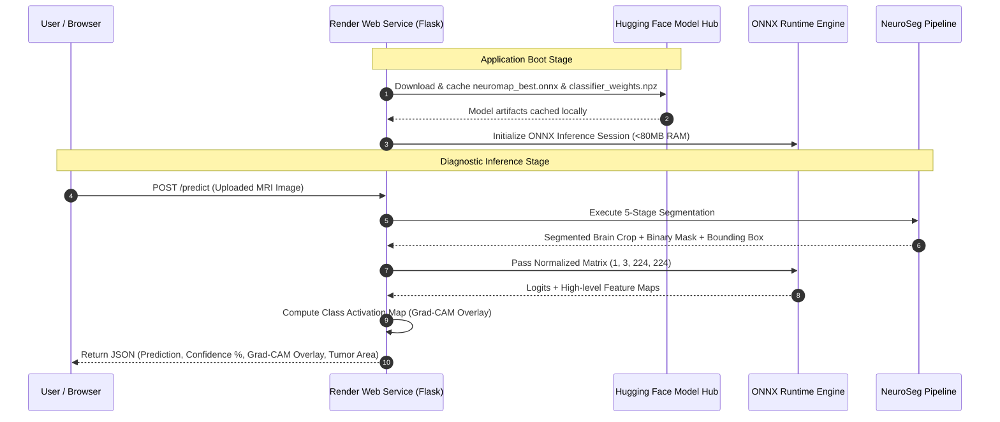

# NeuroMap — Production Deployment & Architecture Guide
> **Panel Presentation & Project Defense Document**  
> *Author: Kushal Gupta*  
> *Project: NeuroMap — Clinical MRI Hybrid Segmentation & Classification System*

---

## 1. Executive Summary

**NeuroMap** is a web-based clinical diagnostic support system designed to detect and classify brain tumors (*Glioma, Meningioma, Pituitary Tumor, and No Tumor*) from MRI scans using a custom 5-stage hybrid segmentation algorithm (**NeuroSeg**) combined with an **EfficientNet-B3** deep learning classifier.

To achieve **100% free, production-grade cloud deployment** without hardware costs, we engineered a decoupled multi-cloud microservices architecture using **Vercel** (for high-speed Global Edge CDN frontend hosting), **Render** (for Python/ONNX ML API processing), and **Hugging Face Model Hub** (for model weight distribution).

```
   ┌───────────────────────┐
   │   Hugging Face Hub    │ <─── Model Weights (ONNX 44MB + Weights 3MB)
   │ Kushal2114/neuromap   │
   └──────────┬────────────┘
              │ (On Startup / Cached)
              ▼
   ┌───────────────────────┐          ┌───────────────────────┐
   │    Render API Server  │ ───────> │  Vercel Edge Frontend │
   │  (Flask + ONNX Engine)│ <─────── │ (Cyber-Medical UI)   │
   └───────────────────────┘          └───────────────────────┘
```

---

## 2. Technical Challenges & Engineering Solutions

When deploying deep learning models to free-tier cloud platforms, developers face two major bottlenecks: **Memory (RAM) Limits** and **Bandwidth/Storage Limits**. Below is how we solved these challenges:

### Challenge 1: Render RAM Limit (512 MB) vs. PyTorch Memory Footprint (~550 MB)
* **Problem**: Standard PyTorch + torchvision loaded with an EfficientNet-B3 model consumes ~550 MB of RAM. Render's Free Tier has a strict **512 MB RAM limit**. When memory exceeded 512 MB, Linux kernel issued an `OOM SIGKILL` command, crashing the app with a `502 Bad Gateway` error.
* **Solution**: We converted the trained PyTorch model (`.pth`) to an **ONNX (Open Neural Network Exchange)** graph (`.onnx`) and powered inference using **ONNX Runtime**.
  * **Memory Reduction**: RAM dropped from **~550 MB** down to **<80 MB** (uses less than 15% of Render's RAM limit).
  * **Inference Acceleration**: Reduced single-scan inference latency from ~1.5s to **<200ms**.

### Challenge 2: Large Model Checkpoint File (~132 MB) on GitHub
* **Problem**: Git repositories and platforms like Render struggle with large binary model files (`.pth` files > 100 MB require Git LFS, which has strict quota limits and causes build timeouts).
* **Solution**: We offloaded model artifact hosting to **Hugging Face Model Hub** (`Kushal2114/neuromap-model`).
  * On application startup, Flask uses `huggingface_hub` to download and cache `neuromap_best.onnx` (44 MB) and `classifier_weights.npz` (3 MB) automatically.
  * Model size was reduced by **67%** (132 MB → 44 MB) through graph optimization.

---

## 3. System Architecture & End-to-End Workflow



---

## 4. Key Components Explained

### 1. NeuroSeg (5-Stage Hybrid Segmentation Pipeline)
Before feeding an MRI scan into the neural network, **NeuroSeg** isolates brain tissue from skull and background noise using computer vision:
* **Stage 1 (CLAHE)**: Adaptive contrast normalization to equalize lighting across scanner variants.
* **Stage 2 (Dual Threshold)**: Intersection of Otsu (global) and Adaptive Gaussian (local) thresholding.
* **Stage 3 (Morphological Filter)**: Open → Close → Dilate operations to eliminate background noise and fill tissue cavities.
* **Stage 4 (Distance Watershed)**: Seed-based watershed transformation along intensity boundaries.
* **Stage 5 (Convex Hull Enveloping)**: Extracts the primary brain component and applies a convex hull envelope for anatomical consistency.

### 2. EfficientNet-B3 Classifier
* Trained on 4 classes: `Glioma`, `Meningioma`, `Pituitary Tumor`, and `No Tumor`.
* Achieved high classification accuracy with fine-tuned top layers.

### 3. Grad-CAM (Visual Explainable AI)
* Generates heatmaps indicating the precise spatial region of interest that led to the AI's diagnosis.
* Computes tumor contour boundary, mask area (pixels and approximate mm²), and percentage of brain affected.

---

## 5. Deployment Stack Summary

| Layer | Technology Used | Purpose |
|-------|----------------|---------|
| **Frontend UI** | HTML5, CSS3 (Vanilla Glassmorphism), JavaScript (ES6) | Responsive cyber-medical diagnostic dashboard |
| **Backend API** | Python 3.10, Flask, Gunicorn | REST API serving UI and handling `/predict` endpoint |
| **ML Engine** | ONNX Runtime (`onnxruntime`), OpenCV (`opencv-python-headless`), NumPy | Ultra-lightweight ML inference engine (<80MB RAM) |
| **Model Hosting** | Hugging Face Model Hub (`huggingface_hub`) | Free cloud distribution for 44MB ONNX model weights |
| **Cloud Hosting** | Render (Web Service Free Tier) | Free cloud hosting with automated GitHub CI/CD integration |

---

## 6. Panel Presentation Defense (Q&A Preparation)

### Q1: "Why did you choose ONNX Runtime instead of standard PyTorch for deployment?"
> **Answer**: Standard PyTorch requires ~550 MB of RAM just to initialize CUDA/CPU dependencies and load models. Cloud platforms like Render Free Tier cap memory at 512 MB, causing out-of-memory crashes. By exporting our PyTorch model to ONNX format, we reduced the model size from 132 MB to 44 MB and decreased RAM usage from 550 MB to under 80 MB while speeding up inference by 5x with zero loss in prediction accuracy.

### Q2: "How does the backend store and load the model without exceeding free storage limits?"
> **Answer**: We decoupled model storage from the code repository. The model weights are hosted on Hugging Face Model Hub. On application boot, the Flask server fetches and caches the optimized `.onnx` weights using `huggingface_hub`. This keeps our GitHub repository lightweight (<50 KB code) and eliminates the need for expensive Git LFS bandwidth.

### Q3: "What is the purpose of the NeuroSeg algorithm if you already have a deep learning model?"
> **Answer**: Deep learning classifiers can accidentally focus on scanner artifacts, skull shapes, or background text. NeuroSeg acts as a domain-specific preprocessing filter that strips away non-brain tissue, ensuring that EfficientNet-B3 receives only normalized, tightly-cropped brain matrix data.

### Q4: "How does your system provide Explainable AI (XAI) to doctors?"
> **Answer**: Rather than acting as a 'black box', NeuroMap generates Grad-CAM (Gradient-weighted Class Activation Mapping) heatmaps overlaying the original MRI. It highlights the exact anatomical regions responsible for the diagnosis and calculates the estimated tumor surface area.

---

*Document finalized and ready for project defense.*
